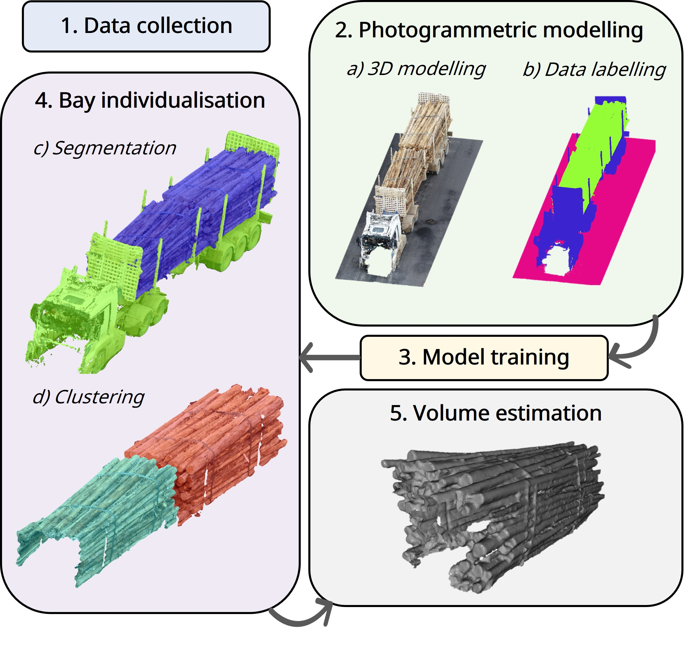

# SemanticTruck

Automated estimation of the **solid wood content of roundwood truckloads** from photogrammetric
point clouds. This is the analysis code for *"Deep learning and photogrammetry for automated solid wood content
estimation in roundwood truckloads"* (Acuna, García-Pascual, Martín-Cortés & de Miguel-Díez). It
covers everything from a segmented point cloud to the reported results: bay individualisation,
base-plane alignment, surface reconstruction, gross-volume integration, the regression to solid
volume, and the sensitivity analysis to select the parameters.



## What is in this repository

The code in this repository reproduces:
- cross-validated training of the segmentation model
- truckload segmentation inference
- preprocessing
- bay individualisation
- alignment
- surface reconstruction
- volume calculation
- statistical model fit
- equivalence test between manual and model segmentation errors
- sensitivity analysis
- computation-time study
- manuscript's figures and tables

The data and the model weights generated in this study are property of Forico Pty Limited. Therefore, **we did not include:**

- **The data.** The truckload scans, raw and labelled. `docs/input-data.md` specifies exactly what is the proper data format, so you can build your own dataset.
- **The segmentation model weights.** The Point Transformer V3 (PTv3) weights and the training data.

The *training code* is in `semantictruck-train`. It runs the five-fold training, but it needs Pointcept and a dataset of your own. The volume pipeline also takes the segmentation as an input, either from a cloud with a `label` field or from per-point label files.

## Install

### Main dependencies

Run the following commands to install the main dependencies:

```bash
git clone <this repository> && cd SemanticTruck
conda env create -f environment.yml
conda activate semantictruck
pip install -e .
```

### Pointcept, for training the segmentation model

**Only needed by `semantictruck-train` and `semantictruck-predict`.** Everything else runs with the install above.

Pointcept is distributed as source with a CUDA extension to compile, so it cannot be installed directly from PyPI using `pip`. It also **needs its own environment**: it requires NumPy 2 and torch 2.5, while `open3d` requires NumPy < 2.

```bash
git clone https://github.com/Pointcept/Pointcept.git
cd Pointcept

conda create -n semantictruck-train -y \
    -c pyg -c pytorch -c nvidia/label/cuda-12.4.4 -c nvidia -c conda-forge \
    python=3.10 pip cuda cudnn gcc=13.2 gxx=13.2 ninja \
    pytorch=2.5.0 torchvision=0.20.0 pytorch-cuda=12.4 \
    h5py pyyaml tensorboard tensorboardx yapf addict einops scipy plyfile \
    termcolor timm ftfy regex tqdm matplotlib
conda activate semantictruck-train
pip install spconv-cu124

# the CUDA extension needed for PTv3
CPATH=$CONDA_PREFIX/targets/x86_64-linux/include/cccl:$CPATH \
    pip install --no-build-isolation ./libs/pointops

# this package, WITHOUT its dependencies
pip install -e /path/to/SemanticTruck --no-deps

export POINTCEPT_ROOT=$PWD          # or pass --pointcept-root to semantictruck-train
```

`docs/reproducing.md` covers running the training and the inference.

## Use

Export the path to your dataset, formatted as described in `docs/input-data.md`:

```bash
export SEMANTICTRUCK_DATA=/path/to/dataset      # or pass --data-root to each command
```

```bash
# The pipeline, at the published configuration
semantictruck-pipeline --out results/pipeline

# The result tables and figures
semantictruck-errors  --table results/pipeline/results_per_truck.csv --by-campaign
semantictruck-tables  --run   results/pipeline
semantictruck-plot-volume --table results/pipeline/results_per_truck.csv --fit-line

# Whether the model segmentation's error is equivalent to the manual one's
semantictruck-paired-errors --table results/pipeline/results_per_truck.csv --margin 1.0

# The sensitivity analysis behind the parameter choices
semantictruck-sensitivity --out results/sensitivity

# What the method costs per truckload
semantictruck-timing --repeats 5
```

Every command can also be run as `python -m semantictruck.cli.<name>`. `semantictruck-train` and `semantictruck-predict` additionally need **Pointcept**, which is installed from source into its own environment.

| Command | Produces |
|---|---|
| `semantictruck-train` | five-fold cross-validated segmentation training, and one out-of-fold prediction per truckload |
| `semantictruck-predict` | segmentation inference using a checkpoint file: per-truckload predictions, metrics, and timings |
| `semantictruck-pipeline` | gross and net volume per bay and per truckload, the fitted model, the bay-split score, per-step timings |
| `semantictruck-sensitivity` | the one-at-a-time parameter sweep and its supplementary figures |
| `semantictruck-timing` | per-truckload computation cost |
| `semantictruck-errors` | the aggregate error table (manuscript Tables 3 and 4) |
| `semantictruck-paired-errors` | paired comparison of the two segmentations' absolute LOO error: Hodges-Lehmann shift with exact CI, BCa bootstrap CI, and a TOST equivalence test |
| `semantictruck-tables` | display manuscript Tables 1, 3 and 4 |
| `semantictruck-plot-volume` | manuscript Figure 4: net vs. gross volume |
| `semantictruck-plot-curves` | manuscript Figure 3: cross-validation training curves |
| `semantictruck-plot-time` | manuscript Figure 5: computation time vs. size |
| `semantictruck-plot-sensitivity` | sensitivity box-and-whisker figure |

Running the pipeline with no `--config` uses the manuscript's configuration.

## Documentation

| | |
|---|---|
| `docs/input-data.md` | Description of the input `.laz` and CSV data. Read this first if you are bringing your own data |
| `docs/reproducing.md` | command by command, from a dataset to each published table and figure, and how to train the segmentation model |

## Citing

See `CITATION.cff`. Please cite the original paper if you use our code.

## Licence

MIT. See `LICENSE`.
